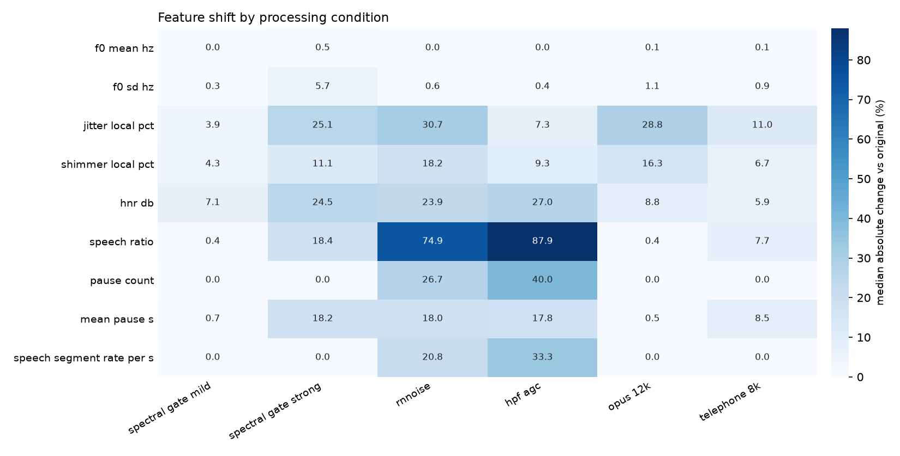

# speech-processing-stability-check

[](LICENSE)

A small Python command-line tool that measures **how much standard speech
features shift when the same recordings pass through different audio
processing**: noise suppression, automatic gain control, low-bitrate codecs
and the narrow telephone band. These are the kinds of changes a recording can
go through when a study participant uses a different phone, a different app
version, or the same phone after a software update.

Give it a folder of WAV files. It processes each file under every condition,
extracts open, well-known features (Praat voice measures, pause and timing
measures, optionally openSMILE eGeMAPS), and reports per feature:

- the mean shift versus the original recording,
- ICC(2,1) (two-way random, absolute agreement, single measure) versus the
  original and across all conditions,
- the percentage of files whose change exceeds a threshold you set.

It contains no trained model and no proprietary method. Everything is
standard signal processing and textbook statistics, so you can read every
line and reproduce every number.

## Why it matters for clinical trials

Speech and voice measures are increasingly used as digital endpoints and
screening tools in clinical trials, often recorded on participants' own phones
(BYOD) or on provisioned devices at home or on site. The same voice can reach
the analysis pipeline in very different shapes depending on the handset's
noise suppression, the app's gain control, the codec, and the operating-system
version. If a feature moves when only the processing changed, that movement
can be mistaken for a change in the participant.

The U.S. FDA guidance *Digital Health Technologies for Remote Data Acquisition
in Clinical Investigations* (final guidance, December 2023) asks sponsors to
show that a digital health technology measures the clinical characteristic
reliably across the conditions in which it will be used, and to consider the
effect of software and hardware updates during a trial. A quick processing
stability check like this one is a practical first step: it shows which
features hold steady and which ones need care before they are relied on.

- FDA (2023). *Digital Health Technologies for Remote Data Acquisition in
  Clinical Investigations. Guidance for Industry, Investigators, and Other
  Stakeholders.* https://www.fda.gov/regulatory-information/search-fda-guidance-documents/digital-health-technologies-remote-data-acquisition-clinical-investigations

## Install

Requires Python 3.9+. `ffmpeg` on your `PATH` enables the codec conditions;
without it they are skipped.

```bash
git clone https://github.com/Cephalgo/speech-processing-stability-check.git
cd speech-processing-stability-check
python -m venv .venv && source .venv/bin/activate
pip install -e ".[all]"      # or: pip install -e .   (core only)
```

Optional extras: `plot` (matplotlib heatmap), `egemaps` (openSMILE),
`rnnoise` (RNNoise via `pyrnnoise`), `all` (all three), `dev` (pytest).

## Usage

```bash
# list the processing conditions
speech-stability-check list-conditions

# run on a folder of WAV files (searched recursively)
speech-stability-check run path/to/wavs -o results --plot

# choose conditions, a 5% threshold, add eGeMAPS, keep processed audio
speech-stability-check run path/to/wavs -o results \
    -c spectral_gate_strong rnnoise telephone_8k -t 5 --egemaps --save-audio

# make synthetic test clips (no recordings needed)
speech-stability-check make-synthetic demo_audio --n 8
```

### Conditions

| Name | What it does |
|---|---|
| `original` | Unprocessed input (the reference) |
| `spectral_gate_mild` | `noisereduce` non-stationary spectral gating, 50% reduction |
| `spectral_gate_strong` | `noisereduce` non-stationary spectral gating, 100% reduction |
| `rnnoise` | RNNoise recurrent-network noise suppression (`pyrnnoise`) |
| `hpf_agc` | 80 Hz high-pass, automatic gain control and soft limiter (a simple WebRTC-style approximation, not WebRTC code) |
| `opus_12k` | Opus 12 kbit/s VoIP-mode round trip (ffmpeg + libopus) |
| `amr_nb` | AMR-NB 12.2 kbit/s round trip (ffmpeg built with libopencore-amrnb) |
| `telephone_8k` | Resample to 8 kHz, 300-3400 Hz band-pass, resample back |

Every condition returns audio at the input sample rate and length. A
condition whose dependency is missing is skipped and listed in
`skipped_conditions.csv`.

### Features

| Group | Features |
|---|---|
| Praat (parselmouth) | `f0_mean_hz`, `f0_sd_hz`, `jitter_local_pct`, `shimmer_local_pct`, `hnr_db` |
| Energy VAD timing | `speech_ratio`, `pause_count`, `mean_pause_s` (internal pauses of 150 ms or more), `speech_segment_rate_per_s` |
| openSMILE (optional) | the 88 eGeMAPS v02 functionals, prefixed `egemaps_` |

### Outputs

| File | Content |
|---|---|
| `features.csv` | One row per file and condition, one column per feature |
| `summary.csv` | One row per feature and condition: `mean_original`, `mean_shift`, `mean_shift_pct`, `median_abs_change_pct`, `icc21_vs_original`, `pct_files_over_threshold`; plus one `ALL` row per feature with `icc21_all_conditions` |
| `stability_heatmap.png` | Median absolute change per feature and condition (with `--plot`) |

Relative change is `|condition - original| / |original|`, per file. For
features that can be near zero (for example `pause_count` on a short clip),
read `mean_shift` alongside the percentage.

## Example output

The `examples/` folder holds eight **synthetic** clips (source-filter vowels
from a Rosenberg glottal pulse train with jitter, shimmer and pink background
noise at 10-30 dB SNR; no human voice, no text-to-speech) and the full output
of:

```bash
speech-stability-check run examples/audio -o examples/output --plot --egemaps
```

Median absolute change versus the original (%), last column ICC(2,1) across
all conditions (`amr_nb` was skipped because the local ffmpeg had no AMR
encoder):

| Feature | gate mild | gate strong | rnnoise | hpf_agc | opus_12k | tel. 8k | ICC(2,1) all |
|---|---:|---:|---:|---:|---:|---:|---:|
| f0_mean_hz | 0.0 | 0.5 | 0.0 | 0.0 | 0.1 | 0.1 | 0.99 |
| f0_sd_hz | 0.3 | 5.7 | 0.6 | 0.4 | 1.1 | 0.9 | 0.55 |
| jitter_local_pct | 3.9 | 25.1 | 30.7 | 7.3 | 28.8 | 11.0 | 0.58 |
| shimmer_local_pct | 4.3 | 11.1 | 18.2 | 9.3 | 16.3 | 6.7 | 0.38 |
| hnr_db | 7.1 | 24.5 | 23.9 | 27.0 | 8.8 | 5.9 | 0.39 |
| speech_ratio | 0.4 | 18.4 | 74.9 | 87.9 | 0.4 | 7.7 | 0.25 |
| pause_count | 0.0 | 0.0 | 26.7 | 40.0 | 0.0 | 0.0 | 0.60 |
| mean_pause_s | 0.7 | 18.2 | 18.0 | 17.8 | 0.5 | 8.5 | 0.44 |
| speech_segment_rate_per_s | 0.0 | 0.0 | 20.8 | 33.3 | 0.0 | 0.0 | 0.42 |



How to read it: mean F0 barely moves under any condition, while jitter,
shimmer, HNR and the energy-based timing measures shift by double-digit
percentages under noise suppression or gain control. These numbers come from
eight synthetic clips and only illustrate the output format; they are not a
benchmark. Run the tool on recordings that match your own study (devices,
languages, tasks, rooms) and use enough files for stable ICC estimates.

## Tests

```bash
pip install -e ".[dev]"
pytest -q
```

The tests run entirely on synthetic audio: ICC against the published
Shrout & Fleiss (1979) worked example, F0 recovery on a synthetic vowel train,
pause detection on a known signal, length and range checks for every
condition, band-limit checks for the telephone condition, and an end-to-end
CLI run.

## Limitations

- The `hpf_agc` condition is a transparent approximation of a WebRTC-style
  front end, not the WebRTC audio-processing module. Real phones apply
  vendor-specific processing that no open tool reproduces exactly.
- The energy VAD is deliberately simple. Timing measures from a different VAD
  will respond differently to processing.
- ICC from a handful of files has wide uncertainty.
- openSMILE is distributed by audEERING under its own licence terms; check
  them before commercial use of the `--egemaps` option.

## References

- Shrout, P. E., & Fleiss, J. L. (1979). Intraclass correlations: uses in
  assessing rater reliability. *Psychological Bulletin*, 86(2), 420-428.
- Koo, T. K., & Li, M. Y. (2016). A guideline of selecting and reporting
  intraclass correlation coefficients for reliability research. *Journal of
  Chiropractic Medicine*, 15(2), 155-163.
- Boersma, P., & Weenink, D. Praat: doing phonetics by computer.
  https://www.praat.org (Python interface: parselmouth).
- Eyben, F., et al. (2016). The Geneva Minimalistic Acoustic Parameter Set
  (GeMAPS) for voice research and affective computing. *IEEE Transactions on
  Affective Computing*, 7(2), 190-202.
- Valin, J.-M. (2018). A hybrid DSP/deep learning approach to real-time
  full-band speech enhancement (RNNoise). *IEEE MMSP*.
- Sainburg, T., et al. noisereduce. https://github.com/timsainb/noisereduce

## About

Maintained by [Cephalgo](https://www.cephalgo.com), which provides speech
biomarkers for CNS clinical trials that stay stable across phone and software
changes.

## Licence

MIT. See [LICENSE](LICENSE).
